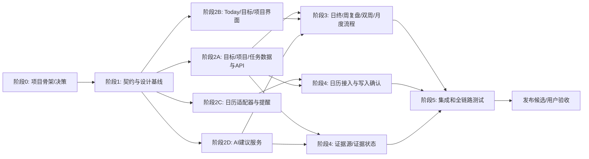

# Goal Monitor — 开发计划与任务分解

**版本：** 0.1  
**依据：** [`goal-monitor-workflows.md`](./goal-monitor-workflows.md)  
**当前状态（2026-11-20）：** Phase 4a–4g 均已实现并通过 Antigravity 独立交叉验收；本机 localStorage MVP 的端到端流程通过。真实日历账号、AI 服务、自动证据源、硬件及云同步未连接，作为后续独立集成工作。

## 1. 产品目标

交付一款个人目标监控 Web App，将长期方向连接到 12 个月里程碑、30 天项目、每周检查点和每日杠杆任务；用日历安排工作、用证据区分投入与实际产出，并通过日终/周度/双周/月度回顾帮助用户校准行动。

首个可编辑示例是用户的数据工程/AI 职业收入和选择空间目标。应用不得把该草案写死为真实承诺。

## 2. 工作拆分和依赖图

### 阶段总览

### 可并行工作

阶段 2A、2B、2C、2D 在接口契约、数据模型、UI wireframe 和测试标准冻结后可并行。各模块使用接口 mock，避免互相等待。

### 必须顺序执行

- 先确定仓库、框架、认证/本地存储策略、数据模型和接口契约，再并行实现。
- 日历真实写入必须晚于只读同步、时区/事件状态处理和用户确认 UI。
- 证据自动确认必须晚于来源适配、关联规则、置信度阈值和待确认流程。
- 日周复盘服务必须依赖任务/证据模型；集成测试必须在各模块交叉测试通过后执行。
- 部署/发布在端到端验收及安全/隐私检查完成后执行。

## 3. 执行人与交叉测试政策

当前环境可直接执行者：Codex（当前主执行者）。用户提到的 “Ntic gravity” 按 **Antigravity** 理解。

| 标记 | 含义 |
|---|---|
| **Codex** | 主实现者，可在当前工作区直接改代码/文档 |
| **Cloud** | 建议实现/测试负责人；需连接相应 Cloud workspace/worker 后派发 |
| **Antigravity** | 建议实现/测试负责人；需相应 Antigravity agent/workspace 后派发 |
| **需调度入口** | 当前会话没有可调用的该代理派发工具；此列是计划分工，不代表已分派或已执行 |

交叉测试规则：每个实现任务至少由不同于实现者的角色独立验证。跨代理任务只有在代理可实际调用时才算通过；无法调用时由 Codex 执行临时代替验证，并标注为“待独立代理复测”，不能伪称交叉完成。每任务须附运行命令、通过/失败结果、缺陷和证据链接或截图。

## 4. 任务清单

优先级：P0 = MVP 阻塞；P1 = 首版重要；P2 = 后续扩展。

### 阶段0 — 项目骨架和决策

| ID | Task | 依赖 | 建议实现者 | 交叉测试者 | 验收标准 |
|---|---|---|---|---|---|
| T00 | 检查仓库/选择应用框架，建立可运行的开发骨架、README、环境配置示例 | 无 | **Codex** | Cloud | 新开发者按 README 可启动；不包含真实密钥；首页可打开 |
| T01 | 定义 ADR：本地/云存储、登录、目标时区、AI provider、部署假设与隐私边界 | T00 | **Codex** | Antigravity | 决策及替代方案、影响、未决问题有记录；默认时区可配置 |
| T02 | 固化领域模型、API schema、事件/状态枚举、错误格式与 mock fixtures | T01 | **Codex** | Antigravity | 前后端契约可独立使用；覆盖目标、项目、任务、证据、review、提醒 |
| T03 | UX 信息架构与主要页面 wireframe（Today、Goal、Project、Review、Settings） | T01 | **Antigravity** | Cloud | 页面状态包含空、加载、错误、待确认；关键操作有确认/撤销路径 |

### 阶段1 — 独立基础模块（可并行）

| ID | Task | 依赖 | 建议实现者 | 交叉测试者 | 验收标准 |
|---|---|---|---|---|---|
| T10 | Goal/Project/Milestone/Task CRUD 与层级约束 | T02 | **Codex** | Antigravity | 可创建/编辑/归档；支持草稿、待确认、活跃等状态；拒绝无效父子关系 |
| T11 | 证据和状态领域服务：已确认、待确认、未观察、来源延迟/断开 | T02 | **Codex** | Cloud | 日历事件不能自动充当产出；缺失证据不会判失败；状态变更可审计 |
| T12 | Today 首页与目标/项目视图 | T02,T03 | **Antigravity** | Cloud | 显示方向链、今日最多3任务、完成标准、状态和下一步；键盘/窄屏可用 |
| T13 | 通知/提醒调度抽象与用户偏好 UI（时区、时间、静音、稍后提醒） | T02,T03 | **Antigravity** | Codex | 支持周计划、日终、专注块前、周复盘、双周/月末提醒配置；可暂停 |
| T14 | AI provider 抽象、结构化输出 schema、mock provider | T02 | **Codex** | Antigravity | AI 输出动作/关联/完成标准/依据/不确定点；错误、超时、无 key 有降级 |

### 阶段2 — 用户工作流（部分并行）

| ID | Task | 依赖 | 建议实现者 | 交叉测试者 | 验收标准 |
|---|---|---|---|---|---|
| T20 | 首次设置引导：五年方向、基线、年度里程碑、可用时间、限制 | T10,T12,T14 | **Codex** | Antigravity | AI 只起草；用户确认前不创建活跃目标；可跳过未知项 |
| T21 | AI 生成30天项目和周检查点草案，支持编辑/确认/拒绝 | T10,T14,T20 | **Codex** | Cloud | 生成可交付成果、证据规则、假设；写入前预览确认；重复提交幂等 |
| T22 | 周计划：综合剩余任务和时间预算，产出最多3个杠杆任务 | T10,T11,T12,T14 | **Codex** | Antigravity | 任务有完成标准/时间块/证据规则；未确认不写日历 |
| T23 | 日终回顾：合并已观察证据和用户反馈，生成下一步草案 | T11,T12,T14 | **Codex** | Cloud | 允许跳过/更正；AI 区分事实/推断；空记录不被伪造为失败 |
| T24 | 周度复盘、双周检查、月末/季度回顾界面及决策记录 | T10,T11,T12,T14 | **Antigravity** | Codex | 可选择继续/缩小/换时段/寻求反馈/调整项目；保存理由及时间 |

### 阶段3 — 日历和证据连接

| ID | Task | 依赖 | 建议实现者 | 交叉测试者 | 验收标准 |
|---|---|---|---|---|---|
| T30 | 日历适配器：授权、只读事件导入、时区、取消/改期和同步状态 | T02,T13 | **Codex** | Cloud | token 安全存储；拒绝授权可用手动模式；重复同步不重复事件 |
| T31 | 用户确认后写入/更新/取消日历专注块，含冲突预览和幂等键 | T30,T22 | **Codex** | Antigravity | 明确用户确认前不写；失败可重试；本地改期与远端更新可追踪 |
| T32 | 首个证据源适配器（推荐 GitHub；可替换项目板），事件映射及来源健康状态 | T02,T11 | **Codex** | Cloud | 授权可撤销；仅读取必要字段；断连/延迟可见；事件不直接误确认 |
| T33 | AI/规则证据匹配、置信度解释、用户确认队列 | T11,T14,T32 | **Codex** | Antigravity | 高置信自动确认仅限用户配置的确定性规则；模糊匹配待确认；记录理由 |

### 阶段4 — 集成、质量和交付

| ID | Task | 依赖 | 建议实现者 | 交叉测试者 | 验收标准 |
|---|---|---|---|---|---|
| T40 | 模块集成与迁移/种子数据：职业案例示例可编辑、可删除 | T10–T33 | **Codex** | Cloud + Antigravity 分别独立验收 | 新环境可启动；示例明确标注为草案；数据迁移/回滚行为说明清楚 |
| T41 | 每 task 独立交叉测试：按本表验收条件形成测试记录 | 对应实现 task | 实现者之外的测试者 | 第三角色抽查 | 每个 task 均有测试者、步骤、结果、缺陷及复测状态；失败任务回到实现者 |
| T42 | 端到端全流程测试：首次设置→周计划→日历→证据→日终→周/双周/月回顾 | T40,T41 | **Cloud** | Codex + Antigravity 分别跑相同关键场景 | 关键 happy path 和异常分支通过；测试数据不污染真实用户数据 |
| T43 | 可访问性、响应式、隐私/安全、备份导出、错误恢复审查 | T40 | **Antigravity** | Codex + Cloud | 键盘导航、窄屏、权限最小化、数据导出/删除和故障说明达标 |
| T44 | 发布候选构建、部署说明、用户验收清单、已知限制 | T42,T43 | **Codex** | Cloud | 按说明可部署/回滚；配置变量有文档；所有 P0 缺陷关闭后才称完成 |

## 5. 测试矩阵与交叉测试流程

### 每个任务的交付包

实现者完成后交付：

1. 修改文件与接口说明。
2. 本任务测试命令和环境前提。
3. 对应验收条目逐项结果。
4. 失败日志/截图/复现步骤。
5. 未覆盖边界及已知问题。

测试者不得只看实现者的结论；需从干净状态独立运行相关场景。失败后开缺陷并指派实现者修复，再由原测试者复测。测试者身份、时间、提交版本和结果写入 `docs/qa/task-test-matrix.md`。

### 全流程必测场景

1. **确认前无副作用**：AI 目标/周计划草案未确认时不写目标库活跃记录、不写日历。
2. **日历不是成果**：安排专注块但无产出证据时，任务仍是待确认/未观察。
3. **来源失效**：GitHub/日历授权撤销或同步延迟时，保留已有数据并显示来源问题，不判失败。
4. **人工作业**：离线学习/对话等不可自动观察任务可通过轻量证据确认。
5. **改期/取消**：反复同步不会产生重复日历事件；取消可正确反映在应用。
6. **AI 不确定**：事实和推断分开显示；用户编辑/拒绝建议后持久化实际决定。
7. **复盘分支**：有进展继续；常未执行则缩小/换时间；执行无进展则重审杠杆或项目；结果信号滞后不误报失败。
8. **时区/DST**：Australia/Melbourne 夏令时边界、跨日事件和用户改时区时提醒准确。
9. **权限/隐私**：拒绝集成、撤销授权、导出/删除数据均可工作。
10. **多设备/重试**：提交幂等、离线/超时提示清晰、重试不重复建记录。

## 6. 发布门槛

- 所有 P0 task 的交叉测试通过；若受限于代理不可用，必须标注独立交叉测试待完成，不得用 Codex 自测冒充。
- T42 至少由 Cloud 与 Antigravity 各自独立执行关键端到端场景；测试证据和缺陷记录可审阅。
- 所有阻塞缺陷关闭；其他缺陷有明确影响和临时处理办法。
- 备份/导出、授权撤销、时区和 AI 失败降级验证完成。
- 用户完成真实目标数据验收后才可把示例草案设为活跃目标。

## 7. 当前阻塞与启动所需条件

编写计划时当前目录只有规格文档；此后已由 Codex 在当前工作区创建本地 MVP。Claude agent 两次均在启动前超时，未产生代码；因此 MVP 由 Codex 接手实现。Antigravity 可用并完成了计划审查，应用代码的独立交叉测试仍待执行。当前没有配置 Cloud worker。

MVP 技术决策是 React + TypeScript + Vite 的本机单用户应用，浏览器 localStorage 保存数据。接下来代理只承担独立只读验收或拥有明确文件边界的工作；共享工作区禁止同时写同一文件。真实日历、AI 和证据源需要后续单独接入与授权。

## 8. Antigravity 独立 QA 审查后的修订

Antigravity 指出原计划存在流程阶段与实现依赖不一致、时间/AI/隐私验收不足，以及在共享工作区中交叉测试没有清晰隔离规则等问题。实现时按以下规则解释本任务表；后续如继续做真实集成，应把表格依赖同步改成这些规则：

1. **手动基础路径先可用。** T22 周计划可在用户手动输入空档时运行，不要求先连接日历；连接日历后，周计划再使用只读空闲时间。T23 日终回顾在无证据源时可用用户记录；自动归集证据是 T32/T33 完成后的增强路径。T24 同样先支持手动复盘，外部信号按可用性显示。
2. **明确集成依赖。** 周计划的“日历空档建议”依赖 T30 只读日历；周计划写入事件依赖 T31 且须确认。自动日终证据卡依赖 T32 和 T33。AI 的证据匹配永远不能因模型建议而越过用户确认规则。
3. **补齐时间测试。** 覆盖 Melbourne 时区、夏令时切换前后、跨午夜事件、本地日历日、用户更改时区、重复/漏发提醒、日历改期/取消、同步延迟以及同一任务多次触发的幂等行为。
4. **补齐 AI 契约测试。** 覆盖结构化输出格式错误、空/矛盾输入、外部文本提示注入、超时/限额/离线、重试幂等、低置信匹配不得自动确认、用户拒绝/修改后不得静默重写，以及 AI 不得未经确认改目标或日历。
5. **补齐数据与并发测试。** 覆盖本机数据导出/清除、撤权后数据源停止读取、最小权限、损坏存储恢复、同一实体并发修改冲突、重复 webhooks/同步事件和不同浏览器的单机数据边界说明。
6. **让交叉测试可执行。** 实现者和测试者不得同时写同一工作区。交叉测试只读源码与运行应用，按实现版本号/工作树快照登记；缺陷交回实现者修复，再由原测试者复测。测试依赖只指向已完成实现，不能形成“实现等测试、测试等实现”的循环。代理不可用时可由 Codex 临时做可执行性验证，但必须标记“独立交叉测试待完成”，不得记为通过。

## 9. 当前本地 MVP 范围说明

首个可运行版本在当前仓库以本机 React/TypeScript 应用实现。它覆盖目标/项目/行动视图、用户确认任务、日终/周/双周/月末复盘、本机保存和导出备份；AI 建议、日历和证据源明确作为未连接的演示/占位状态。真实后台提醒、跨设备同步、真实 AI、OAuth 日历、GitHub/项目板自动证据和完整权限/并发测试仍属于后续集成，不得按 MVP 已完成计算。

## 10. Phase 2：本机提醒与日历导出（已实现并交叉验收）

在获得日历账号授权前，先实现本机可控提醒和 ICS 文件导出。这一阶段不访问外部账号、不声称同步；浏览器关闭时不保证定时提醒。

| ID | Task | 依赖 | 实现者 | 独立测试者 | 验收标准 |
|---|---|---|---|---|---|
| T50 | 纯函数 ICS 导出模块：VEVENT 文本转义、UTF-8 行折叠、UTC DTSTART/DTEND、确定性 UID | 当前 ActionTask 计划时间字段 | Antigravity（独立文件 `src/calendarExport.ts`） | Codex | **通过**：31 项 RFC 5545 聚焦测试；中文/emoji UTF-8 折叠、CRLF、转义、UID、时区/时长均有覆盖 |
| T51 | 任务日期/时间/时长编辑；导出已安排行动的 `.ics`；导入说明和无事件空状态 | T50 | Codex | Antigravity | **通过**：排期刷新后持久化；只导出已安排任务；浏览器下载正常；明确为手动导入、不连接日历账户 |
| T52 | 本机提醒偏好：每日回顾时间、每周复盘星期/时间、专注块提前提醒、浏览器通知权限 | 无 | Codex | Antigravity | **通过**：权限仅由显式点击请求；拒绝时应用内提醒仍可用；偏好 localStorage 保存 |
| T53 | 当前页面运行时提醒调度：当天任务专注提醒、日终/周复盘提醒、重复抑制 | T51,T52 | Codex | Antigravity | **通过**：本地时间窗口、日历日去重与 DST 场景通过；页面/浏览器关闭时不承诺触达 |
| T54 | Phase 2 交叉验收：导出文件结构、触发边界、权限拒绝、夏令时、本地日期、通知去重与窄屏交互 | T50–T53 | Codex 集成 | Antigravity 独立验收 | **通过**：`npm test` 48/48、`npm run build`、浏览器流程通过，320px 无水平溢出；记录见 `docs/qa/task-test-matrix.md` |

### Phase 2 明确边界

- ICS 是“导出后由用户导入日历”的单向文件，不是 OAuth 连接或实时同步。
- Web Notification 仅在用户主动授权并且应用页面仍运行时可尝试提醒；系统/浏览器可能节流，应用内状态是降级路径。
- 不在后台推送、Service Worker、真正跨设备日历同步、Google OAuth 或 Apple Health/Watch 接口上作出已经实现的承诺。
- 先完成 ICS / 本机提醒并经独立测试，再决定用户是否愿意授权真正的日历读写。

## 11. Phase 3a：目标进展反馈闭环

真实日历、GitHub 和 AI provider 尚未授权或配置时，继续利用本地任务状态提供可解释的日反馈。规则只能描述存储的数据，不推断未记录的工作、结果或动机；`pending` / `unobserved` 不自动等同失败。

| ID | Task | 依赖 | 实现者 | 独立测试者 | 验收标准 |
|---|---|---|---|---|---|
| T55 | 纯函数每日反馈引擎：当日排期、已确认、待核实、最小下一步；显式区分已开始行动和空白状态 | T51、T11 | Codex | Antigravity | **通过**：覆盖排期/无排期/全完成/待核实/进行中/无任务；无失败推断或 AI/因果声称 |
| T56 | 首页进展反馈卡：显示规则来源、计数、完成标准和开始/继续操作 | T55 | Codex | Antigravity | **通过**：开始行动转为进行中并导航项目；成果计数仍只统计已确认；390×844 无横向溢出 |
| T57 | 独立交叉验收反馈闭环与回归全套 | T55,T56 | Codex 集成 | Antigravity | **通过**：Antigravity 运行 56/56 测试与生产构建；检查 7 种状态、交互及窄屏，报告无缺陷 |

## 12. Phase 3b：日/周/月复盘证据汇总

| ID | Task | 依赖 | 实现者 | 独立测试者 | 验收标准 |
|---|---|---|---|---|---|
| T58 | 按日/本周（周一至周日）/滚动双周/自然月统计所选区间内任务当前状态；明确是排期区间而非完成时间 | T55,T11 | Codex | Antigravity | **通过**：本地日期边界正确；状态分开统计，未排期单列，不推断完成日期 |
| T59 | 在日终/周/双周/月末复盘弹窗显示区间、自动状态汇总与一条可编辑思考提示 | T58,T24 | Codex | Antigravity | **通过**：手写决定可保存；提示不自动填入决定；空数据不解释为失败；窄屏易读 |
| T60 | 复盘自动汇总独立交叉验收 | T58,T59 | Codex 集成 | Antigravity | **通过**：Antigravity 检查区间、状态、保存和 390×844 窄屏，60/60 测试及构建通过 |

## 13. Phase 3c：职业/财务结果指标

结果指标是可选、手动维护的滞后信号（如年薪、月储蓄、面试数）。每日任务仍是领先行动；二者分开呈现，不因任务已完成而声称收入结果已经发生。默认不预填个人金额，也不读取银行账户。

| ID | Task | 依赖 | 实现者 | 独立测试者 | 验收标准 |
|---|---|---|---|---|---|
| T61 | GoalPlan 支持多个 outcome metrics：名称、单位、方向、基线、目标、当前值、更新时间/证据 | T10,T20 | Codex | Antigravity | **实现完成**：可为空；兼容旧目标；上升/下降进度函数；验证目标值与基线不相等 |
| T62 | 目标编辑中新增/移除指标表单；Dashboard 显示独立结果信号卡和目标进度 | T61 | Codex | Antigravity | **实现完成**：手动更新并本机保存；结果信号与每日行动分离；无预填个人金额 |
| T63 | 指标模型/表单/进度组件单测和响应式检查 | T61,T62 | Codex | Antigravity | **Codex 自测通过**：67 项测试及生产构建；上升、下降、越界、无效值、旧数据迁移；390px 浏览器实测增改/更新，无横向溢出 |
| T64 | 结果指标独立交叉验收 | T61–T63 | Codex 集成 | Antigravity | **通过**：只读复测模型迁移、验证、升/降目标进度、增删/更新、证据备注、行动完成分离、空状态和窄屏；0 缺陷/溢出，演示数据已恢复 |

## 14. Phase 3d：结果指标历史趋势

当前值和目标进度可以表达“现在在哪里”，但单一快照无法看出变化方向。本阶段在用户更新结果信号时保留本机时间序列，并以趋势线呈现；它只展示记录值，不对职业或财务结果作因果判断。

| ID | Task | 依赖 | 实现者 | 独立测试者 | 验收标准 |
|---|---|---|---|---|---|
| T65 | 指标历史快照与旧数据迁移 | T61 | Codex | Antigravity | **通过**：新建指标及每次手动更新写入时间、数值和备注；旧指标自动迁移为空历史，不伪造历史点 |
| T66 | Dashboard 历史趋势图 | T65 | Codex | Antigravity | **通过**：可访问 SVG 趋势图显示基线/目标参考线和已记录点；空历史有清晰说明；窄屏不溢出 |
| T67 | 历史数据/趋势图测试与浏览器检查 | T65,T66 | Codex | Antigravity | **通过**：69 项测试与构建通过；快照、点位映射、旧数据迁移、单点/多个点；趋势不改变行动状态 |
| T68 | 趋势功能独立交叉验收 | T65–T67 | Codex 集成 | Antigravity | **通过**：独立运行全量测试与构建；浏览器走查更新记录、趋势图和 390×844 无溢出；演示数据恢复；零缺陷 |

## 15. Phase 3e：复盘中连接结果信号与行动记录

把期间实际记录的结果指标变化带进周、双周、月度和日终回顾，让用户能同时看到领先行动与滞后结果。视图必须强调同期变化不等于因果关系；没有期间记录时显示当前值和最近更新时间，不判为失败。

| ID | Task | 依赖 | 实现者 | 独立测试者 | 验收标准 |
|---|---|---|---|---|---|
| T69 | 提取复盘共用本地日期区间 | T58 | Codex | Antigravity | **通过**：复用本地日/周/双周/月窗口，与任务复盘区间一致 |
| T70 | 计算所选区间的指标快照数与变化并集成到复盘弹窗 | T65,T69 | Codex | Antigravity | **通过**：有快照显示次数和变化；无记录说明最近值/更新时间；强调不推断因果 |
| T71 | 指标复盘上下文与 UI 自动化/窄屏验证 | T70 | Codex | Antigravity | **通过**：73 项测试、生产构建；多点、单点、无数据、区间边界；390×844 每周复盘无溢出 |
| T72 | 复盘结果信号独立交叉验收 | T69–T71 | Codex 集成 | Antigravity | **通过，零缺陷**：日期范围、零/单/多点、对照基准、无因果声明和复盘输入均验收通过；演示数据已恢复 |

## 16. Phase 4a：多目标工作区

将当前单个目标扩展为用户可切换的多个独立目标工作区，让职业、财务和其他生活目标可以共用一套提醒/日历工具，同时让每个工作区拥有各自的目标计划、行动、结果指标和复盘记录。旧版单目标数据需原样迁移到默认工作区。

| ID | Task | 依赖 | 实现者 | 独立测试者 | 验收标准 |
|---|---|---|---|---|---|
| T73 | GoalWorkspace 模型、当前目标投影与旧版 localStorage 迁移 | T10,T61,T65 | Codex | Antigravity | **通过**：旧单目标数据迁入默认工作区；目标、行动和复盘隔离投影及回写正确 |
| T74 | 新建/切换目标 UI | T73 | Codex | Antigravity | **通过**：添加名称/五年方向；切换后仪表盘、行动、指标和复盘按所选目标呈现 |
| T75 | 数据隔离/浏览器持久化/移动端测试 | T73,T74 | Codex | Antigravity | **通过**：77 项测试、生产构建；创建目标、添加独立行动、切回职业目标、刷新恢复；390×844 可新增和切换，无溢出 |
| T76 | 多目标隔离独立交叉验收 | T73–T75 | Codex 集成 | Antigravity | **通过，零缺陷**：旧数据迁移、跨目标创建/切换/隔离、刷新和 iPhone 12 390×844 验收；演示数据恢复 |

## 17. Phase 4b：跨目标日历与提醒

多目标任务各自保存，但排期要能放在同一个时间视图中规划。本阶段提供周议程、目标标签、所有目标单向 ICS 导出，并让专注提醒指回正确目标；不连接或读取外部日历账户。

| ID | Task | 依赖 | 实现者 | 独立测试者 | 验收标准 |
|---|---|---|---|---|---|
| T77 | 跨目标本地周议程与 ICS 事件组装函数 | T73,T50 | Codex | Antigravity | **通过**：83 项测试/构建；Antigravity 16 项独立 scratch 测试通过；周一至周日边界与排序正确；跳过任务仍留在应用议程便于恢复，但从 ICS 导出排除；未排期不显示 |
| T78 | 新增全目标日历页面 | T77 | Codex | Antigravity | **通过**：可翻看前后周，按日期列出各目标行动及状态；打开事件能切换到目标项目；390×844 下无溢出 |
| T79 | 设置页和日历页导出所有目标 ICS | T77,T78 | Codex | Antigravity | **通过**：只导出有排期且未跳过的任务；ICS 目标标签/UID 合规；说明手动单向导入与本地保存 |
| T80 | 跨目标专注提醒与独立验收 | T77–T79 | Codex 集成 | Antigravity | **通过，零缺陷**：提醒显示目标名并打开正确工作区；同 ID 跨目标不冲突；独立验收周边界、ICS 内容、去重和 390px 布局；演示数据恢复 |

## 18. Phase 4c：从日历行动到结果证据

把日历从只读周议程升级为行动执行入口。用户可以开始、确认完成或跳过已排期行动，并可记录完成证据；状态始终写回行动所属目标。排期和开始状态不计入成果，只有用户显式确认才计入已确认行动数。

| ID | Task | 依赖 | 实现者 | 独立测试者 | 验收标准 |
|---|---|---|---|---|---|
| T81 | 日历行动状态转换与所属工作区更新 | T73,T77 | Codex | Antigravity | **通过**：开始/确认/跳过/恢复只更新所属目标；跨目标隔离及刷新持久化独立验收通过 |
| T82 | 完成证据记录 | T81 | Codex | Antigravity | **通过**：确认时可填写可选证据说明并保存到对应行动；空白/取消不伪造证据，区别于完成标准与证据类型 |
| T83 | 日历行动执行控件与状态反馈 | T81,T82 | Codex | Antigravity | **通过**：根据状态显示开始/确认/跳过/恢复；跳过项留在日历可恢复、但仍从 ICS 排除；390×844 无溢出 |
| T84 | Phase 4c 单元/组件/浏览器与独立验收 | T81–T83 | Codex 集成 | Antigravity | **通过，修复后零缺陷**：85 项测试与构建通过；目标隔离、证据、取消、恢复、ICS、移动端、零控制台错误均复测通过；演示数据恢复 |

## 19. Phase 4d：每周复盘到下周行动

让周复盘成为可执行的闭环：用户写下下一步后，可选择把它作为一项新行动加入当前目标，并补全完成标准和可选排期。系统只创建一项用户明确提交的行动，不自动扩成未确认任务，也不把排期当成果。

| ID | Task | 依赖 | 实现者 | 独立测试者 | 验收标准 |
|---|---|---|---|---|---|
| T85 | 周复盘行动草案字段与确认流程 | T24,T81 | Codex | Antigravity | **通过**：仅周复盘显示可选行动创建；下一步为标题、完成标准必填、排期可选 |
| T86 | 保存复盘与行动的原子状态更新 | T85,T73 | Codex | Antigravity | **通过**：显式提交后复盘与计划行动同次本机状态更新；不选行动时不新增；写入当前目标 |
| T87 | 周复盘创建行动的测试与响应式验证 | T85,T86 | Codex | Antigravity | **通过**：86 项测试与构建；跨目标/刷新/排期/状态计数和完成证据流程均通过 |
| T88 | Phase 4d 独立验收 | T85–T87 | Codex 集成 | Antigravity | **通过，零缺陷**：30 项浏览器验收场景；390×844 无溢出、零控制台错误、演示数据恢复 |

## 20. Phase 4e：多目标今日行动总览

目前用户切换目标后，首页只突出当前目标的行动。对并行推进职业、财务或健康目标的用户，增加跨目标的今日排期总览，减少来回切换并明确每项行动的归属。今日总览只聚合本地日期为今天、未跳过的已排期任务；状态操作写回所属工作区，计划和进行中仍不算已确认成果。

| ID | Task | 依赖 | 实现者 | 独立测试者 | 验收标准 |
|---|---|---|---|---|---|
| T89 | 跨工作区今日行动选择器 | T73,T77 | Codex | Antigravity | **通过**：本地日期筛选，只显示非当前目标当天排期；排除跳过/其他日期/无效日期，按时间排序 |
| T90 | 首页今日总览与目标标记 | T89 | Codex | Antigravity | **通过**：Today 显示其他目标今日排期、目标名、状态和完成标准；无排期时有空状态 |
| T91 | 跨目标今日行动状态交互与响应式 | T90,T81 | Codex | Antigravity | **通过**：开始/确认/跳过写回所属目标；确认可留证据；计划不计成果；390×844 无溢出 |
| T92 | Phase 4e 独立验收 | T89–T91 | Codex 集成 | Antigravity | **通过，零缺陷**：88 项测试和构建；本地日期、排序、跨目标隔离、持久化、零溢出/控制台错误；演示数据恢复 |

## 21. Phase 4f：跨目标周投入预算

目标行动可以单独安排，但多个目标叠加后可能超过用户实际能保护的时间。本阶段增加全局、用户自定的每周专注分钟预算，并对照本周所有目标已排期的分钟数。预算为空时只显示已排期总量；超预算时提供中性调整提示，不自动改期、不把排期当作实际用时或成果。

| ID | Task | 依赖 | 实现者 | 独立测试者 | 验收标准 |
|---|---|---|---|---|---|
| T93 | 每周投入预算字段、旧数据迁移与周负载聚合 | T73,T77 | Codex | Antigravity | **通过**：本地周一至周日汇总所有目标排期；跳过/无效日期处理正确；旧状态预算为空 |
| T94 | 首页预算设置与超载反馈卡 | T93 | Codex | Antigravity | **通过**：可设置/清空预算；显示已排期分钟、余量/超量；中性说明其为排期估算，不自动调整 |
| T95 | 预算逻辑、迁移、交互和窄屏测试 | T93,T94 | Codex | Antigravity | **通过**：92 项测试覆盖边界周、跨目标、跳过/无效日期、缺省/异常/上限预算；390×844 无溢出 |
| T96 | Phase 4f 独立验收 | T93–T95 | Codex 集成 | Antigravity | **通过，零缺陷**：92 项测试与构建；跨目标汇总、持久化、预算提示正确，不影响成果计数；演示数据恢复 |

## 22. Phase 4g：本机 MVP 端到端集成验收

阶段 4a–4f 各功能已分别交叉验收。本阶段从干净演示状态串起全部本机核心工作流，确认多目标状态投影、复盘到计划、排期到证据、结果指标与周预算能共同工作；同时核对数据导出/恢复、响应式表现和已知外部连接边界。不得将外部账号或硬件模拟成已连接。

| ID | Task | 依赖 | 实现者 | 独立测试者 | 验收标准 |
|---|---|---|---|---|---|
| T97 | 新建目标→周复盘→下一步行动集成走查 | T73–T88 | Codex 集成 | Antigravity | **通过**：行动归属正确；完成标准必填；可选排期写入跨目标日历与预算统计 |
| T98 | 日历→开始/跳过恢复/确认证据→复盘集成走查 | T77–T92 | Codex 集成 | Antigravity | **通过**：日历状态、Today 汇总、所属目标、确认产出计数和复盘汇总一致 |
| T99 | 结果指标→预算调整→数据备份/恢复集成走查 | T61–T96 | Codex 集成 | Antigravity | **通过**：指标与行动状态分离；预算变化只影响提示；备份/演示数据恢复行为明确 |
| T100 | 本机 MVP 集成验收与发布边界报告 | T97–T99 | Codex 集成 | Antigravity | **通过，零缺陷**：92 项测试与构建；390×844 无溢出、零控制台错误、演示数据恢复；未连接集成边界已记录 |
