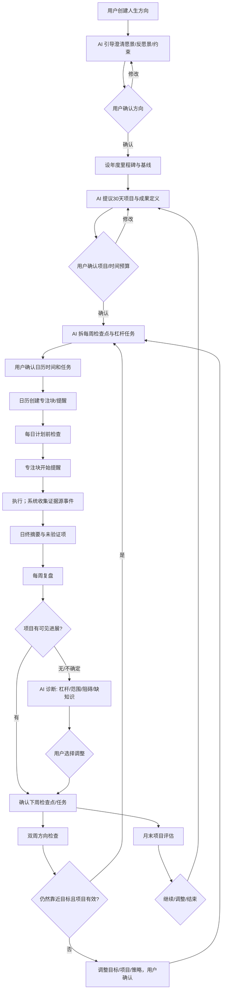
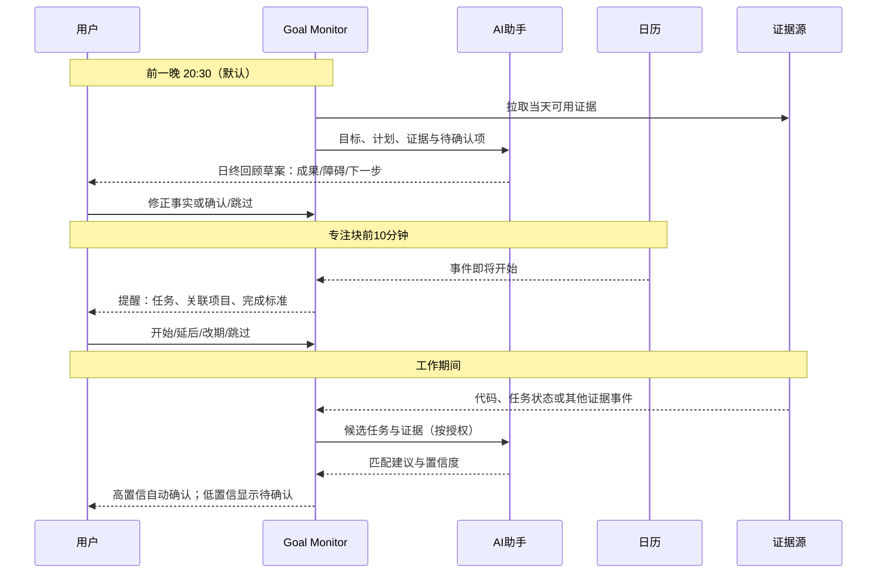

# Goal Monitor — 工作流规格 v0.1

## 目的与边界

把用户的长期方向转成可执行项目，通过日历安排行动、用可观察证据判断进展，并用日/周/双周/月复盘持续校准。首个示例目标是职业收入与选择空间；目标内容均为可编辑假设。

**核心原则**

- 一个活跃主项目；每日最多 1–3 个杠杆任务。
- 计划、投入、产出、结果信号分开记录。日历块不是产出证据。
- AI 提建议、总结和拆解；用户确认目标、计划变更及重要判断。
- 缺少证据时标记“待确认”或“数据未同步”，不自动判失败。
- 用户本地时区驱动提醒；默认时区 Australia/Melbourne，可在设置中修改。

## 角色 / 工具泳道

| 泳道 | 职责 |
|---|---|
| 用户 | 定方向与限制、确认项目/任务、完成工作、处理不可自动观测的结果、作出复盘决策 |
| Goal Monitor | 保存目标层级、生成提醒、汇总证据、维护状态、呈现进展和待办 |
| AI 助手 | 引导目标澄清、提议拆解、生成下一步、归纳复盘、指出偏差；所有写入先预览/确认 |
| 日历 | 保存已确认的专注块/提醒；同步变更和取消 |
| 证据源 | GitHub/项目板/申请记录/财务数据等；按用户授权读取，只把匹配规则的事件作为证据 |

## 端到端主流程

## 时间线 / 触点工作流

提醒时间是建议默认值，可按个人日程调整。所有提醒支持静音、稍后提醒和关闭；不可用的集成显示连接/同步状态。

| 时点 | 触发与系统动作 | 用户输入/动作 | 工具 | AI 参与 |
|---|---|---|---|---|
| 首次设置（约20–30分钟） | 创建方向模板 | 写五年方向、现状、时间预算、限制、证据来源；确认年度里程碑 | Goal Monitor | **AI-1 引导澄清**：追问可验证含义、区分事实/假设；给出草案，不代替用户决定 |
| 首次设置后 | 创建30天项目草案 | 选择/编辑成果、截止日、可投入专注块 | Goal Monitor | **AI-2 项目设计**：把里程碑转成可交付项目，定义成果证据、风险与假设；确认后保存 |
| 每周计划日（默认周日18:00，约10分钟） | 提醒进行周计划；汇总上周产出和下周日历空档 | 选择本周检查点、最多3个杠杆任务、每项完成标准；确认时间 | 日历、证据源 | **AI-3 周计划建议**：根据未完成工作/可用时间提议任务顺序和合理范围；用户确认后才写日历 |
| 每晚（默认20:30，约3分钟） | 显示今日计划、证据和未确认项 | 回答可见成果/障碍/下一步；可跳过，留空不算失败 | Goal Monitor、证据源 | **AI-4 日终教练**：用记录生成简短回顾和一个下一步；允许用户纠正事实 |
| 专注块前10分钟 | 根据日历发提醒，显示任务与完成标准 | 开始、延后、跳过或改期；若改任务则确认 | 日历、通知 | **AI-5 可选启动提示**：把任务压成第一步；不在每次重复打断 |
| 专注块结束/日终同步 | 查找匹配证据；未发现则等待同步窗口 | 对不可自动读取的工作，可附链接/一句确认；无须重复填已发现数据 | GitHub/项目板等 | **AI-6 证据归类**：将事件匹配到任务并说明理由；低置信度只建议，不自动确认 |
| 每周复盘（默认周日18:10，约10分钟） | 显示计划/完成/产出/阻碍/外部信号 | 选继续、缩小、换时段或寻求反馈；确认下周重点 | Goal Monitor、日历、证据源 | **AI-7 复盘归纳**：提炼模式并只建议一项调整，用户决策 |
| 双周检查（第14天，约10分钟） | 提醒检查是否有可见进展 | 判断目标/项目/行动是否仍值得；确认任何策略变更 | Goal Monitor | **AI-8 偏差诊断**：区分“任务未执行”“任务执行但无产出”“证据滞后”“项目假设错误”；提出可验证调整 |
| 月末（约20分钟） | 汇总项目成果、过程信号、结果信号和时间投入 | 选择继续/调整/结束；设下月项目及成果 | Goal Monitor、证据源 | **AI-9 月度回顾**：与基线比较，列事实、推断、未知；产出下月草案，需用户确认 |
| 季度（约30分钟） | 汇总目标趋势及项目历史 | 复核五年方向、年度里程碑与优先级 | Goal Monitor | **AI-10 方向校准**：展示长期方向与实际项目的连接/脱节，用户确认目标修改 |

## 每日泳道时序图

## 状态与决策规则

### 目标/项目层状态

`草稿 → 待确认 → 活跃 → 暂停 / 已完成 / 已归档`

### 任务层状态

`待安排 → 已安排 → 进行中 → 已确认`

其他终态/分支：`待确认证据`、`改期`、`跳过（用户选择）`、`取消`。过期任务不自动标成失败；到日终或周复盘时提示用户处理。

### 证据等级

- **已确认**：用户确认，或匹配明确规则的授权来源事件（如指定 PR 合并）。
- **待确认**：AI/规则找到可能相关事件，但匹配不确定。
- **未观察到**：当前来源没有找到事件；不表示未完成。
- **来源延迟/断开**：数据不可判断，显示同步状态，不触发负面建议。

### 双周偏差判断

1. 有执行、有可见产出：继续或适度提高挑战。
2. 有执行、无里程碑推进：检查任务是否为杠杆、项目定义是否有效。
3. 计划常未执行：缩小任务、换时段或减少本周任务数。
4. 已产出但结果信号滞后：继续积累外部验证，不把滞后当失败。
5. 数据缺失/来源断连：先修数据链路或请求轻量确认，不做目标判断。

## AI 交互契约

AI 可以：澄清、拆解、建议、总结、解释匹配理由、指出信息缺口。

AI 不可静默执行：改变人生方向/年度目标、创建或移动用户日历事件、把待确认证据改成已确认、判定用户失败、提交申请或对外发送消息。

每条建议至少包含：`建议动作`、`关联项目/目标`、`完成标准`、`建议依据`、`不确定点`。涉及写入日历/目标数据时先展示预览并由用户确认。

## 首个示例配置（可编辑）

- 方向：提高数据工程与 AI 系统方面的职业收入与工作选择空间。
- 年度里程碑：通过晋升或新岗位实现可衡量的收入提升（目标金额尚未提供）。
- 30天项目：制作一个展示目标岗位常见要求的案例，并获得外部反馈。
- 每周节奏：3个30–45分钟专注块；周日做周计划/复盘；第14天做方向检查。
- 早期行动信号：岗位需求分析、案例提交/发布、反馈请求、目标岗位申请/交流。
- 滞后结果信号：回复、面试、晋升讨论、薪酬变化。

## MVP 开发顺序

1. 手动建立目标层级、项目、周检查点和任务；支持状态、完成标准、证据链接。
2. Today 首页、日终回顾、周计划/复盘、双周检查与月末评估。
3. 日历只读导入与用户确认后写入专注块；处理改期/取消与时区。
4. AI 草案与确认流程；记录用户采纳/编辑/拒绝，允许纠错。
5. 接入一个证据源（建议 GitHub 或项目板择一），做匹配预览与来源健康状态。
6. 再接财务结果信号或其他目标领域；按用户真实需要扩展。

## 首版验收场景

- 新用户可在引导后确认一个方向、一个项目和每周可投入时间。
- 系统能生成带完成标准和证据规则的周任务草案；未确认前不写日历。
- 日历块只显示投入计划，不会被展示为已完成产出。
- 证据源缺失/断连/同步延迟不会把任务判为失败。
- 日终、周复盘和第14天检查可跳过；跳过不惩罚、不伪造数据。
- AI 输出区分观察事实与推断，并且所有重要数据变更均有用户确认记录。
